<div align="center">

# 🌍 World Explorer

### The whole planet as an interactive 3D open world — live in your browser at 60 FPS.

Fly a commercial airliner, launch a multi-stage rocket into Low Earth Orbit, drive or walk any street on Earth, inspect real-estate parcels with live Photo-to-3D reconstruction, or defend the city from a Kaiju swarm. Real streets, real buildings, real terrain, real weather, and live global telemetry — rebuilt in 3D around you at 1:1 scale as you move.

**[▶ Play it now](https://axieyangb.github.io/world-explorer/)** · [🎬 Watch the 30 s trailer](https://github.com/axieyangb/world-explorer/releases/latest)


<a href="https://axieyangb.github.io/world-explorer/"></a>

</div>

---

## 🌐 Go Anywhere on Earth

Type any place or street address, click the world map, or pass coordinates in the URL. Within seconds, a **40 km × 40 km** open world streams in from Z14 OpenMapTiles vector tiles and AWS Terrarium elevation DEMs off the main thread.

<table>
  <tr>
    <td width="33%">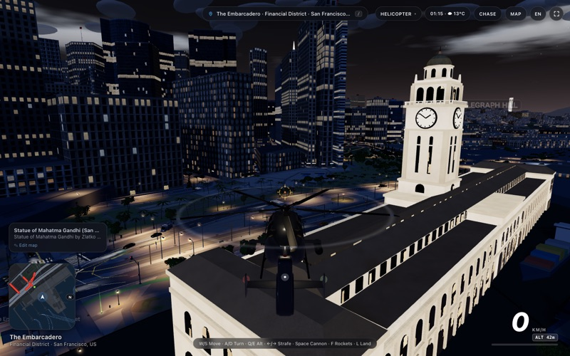<br><sub><b>San Francisco</b> — Ferry Building & raycasted 3D interior cube-mapped skyscraper windows at night</sub></td>
    <td width="33%">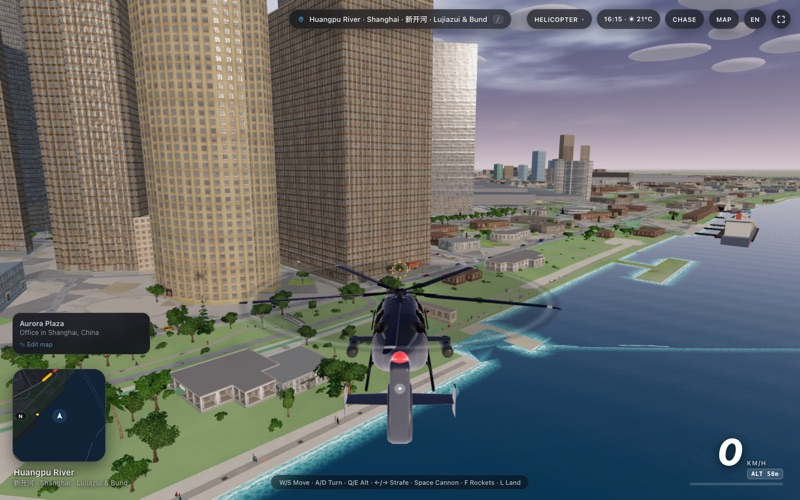<br><sub><b>Shanghai</b> — Lujiazui supertalls, Huangpu River promenade, and docked vessels</sub></td>
    <td width="33%"><br><sub><b>New York</b> — Flying between the towers of Lower Manhattan</sub></td>
  </tr>
  <tr>
    <td><br><sub><b>Tokyo</b> — Shibuya Crossing and neon signage before dawn</sub></td>
    <td><br><sub><b>Sydney</b> — Sunrise over the Opera House and harbour ferries</sub></td>
    <td><br><sub><b>London</b> — Waterloo and the Thames under a full moon</sub></td>
  </tr>
</table>

**Instant Teleport Links:**
[San Francisco](https://axieyangb.github.io/world-explorer/?lat=37.7955&lon=-122.3937&name=San%20Francisco) ·
[Shanghai Lujiazui](https://axieyangb.github.io/world-explorer/?lat=31.2397&lon=121.4998&name=Shanghai) ·
[New York](https://axieyangb.github.io/world-explorer/?lat=40.7060&lon=-74.0130&name=New%20York) ·
[Tokyo](https://axieyangb.github.io/world-explorer/?lat=35.6595&lon=139.7005&name=Tokyo) ·
[Paris](https://axieyangb.github.io/world-explorer/?lat=48.8584&lon=2.2945&name=Paris) ·
[London](https://axieyangb.github.io/world-explorer/?lat=51.5010&lon=-0.1200&name=London) ·
[Sydney](https://axieyangb.github.io/world-explorer/?lat=-33.8570&lon=151.2100&name=Sydney) ·
[Apple Park](https://axieyangb.github.io/world-explorer/?lat=37.3349&lon=-122.0090&name=Apple%20Park) ·
[SpaceX Starbase](https://axieyangb.github.io/world-explorer/?lat=25.9968&lon=-97.1544&name=SpaceX%20Starbase)

---

## 🏛️ 102+ Custom 3D Landmarks, 120+ Tech Campuses & Photo-to-3D World Model

Click **any building, tech campus, or landmark** to open the **Property & Landmark Inspector**:
- **Live Wikimedia Commons & Wikidata Integration**: Fetches real geotagged street/aerial photography (`origin=*`) and live architectural claims (year built, architect, height, floors, structural material).
- **Atlas-Style `Drone Orbit`**: One-click 360° cinematic drone orbit around any building or landmark.
- **Client-Side Photo-to-3D Reconstruction & `.glb` Override**: Project real listing/street photos directly onto 3D building geometry with Sobel-derived normal maps, or drop in a custom World Labs `.glb` parcel mesh.

<table>
  <tr>
    <td width="33%">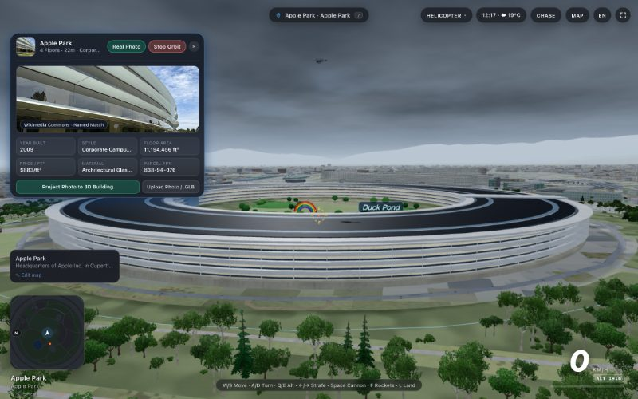<br><sub><b>Apple Park</b> — Norman Foster ring, solar roof, rainbow arches, Duck Pond & live Wikimedia Inspector</sub></td>
    <td width="33%">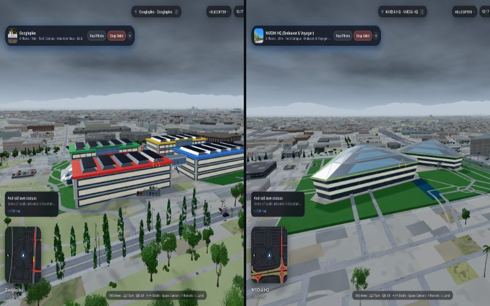<br><sub><b>Googleplex & NVIDIA HQ</b> — Open campus lawns, solar canopies & geodesic triangular domes</sub></td>
    <td width="33%">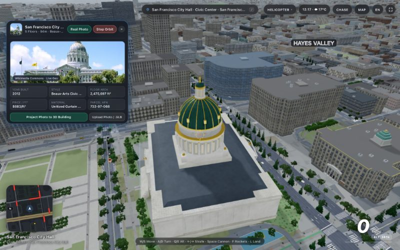<br><sub><b>Photo-to-3D Inspector</b> — SF City Hall Beaux-Arts dome with live photo projection & parcel metadata</sub></td>
  </tr>
</table>

---

## 🚀 Global Spaceports, Multi-Agency Rocket Launches & Live Orbital Earth

Visit **6 authentic global launch complexes**, press **`F / E`** on the pad to ignite a multi-stage orbital launch (`0 → 380 km` LEO), and transition seamlessly into a **real-time J2000/GMST 3D Spherical Earth** surrounded by the Milky Way galaxy and live satellites:
- **SpaceX Starbase (Boca Chica)** — *Starship & Super Heavy* + Mechazilla chopstick catch tower
- **NASA Kennedy Space Center LC-39B** — *Artemis SLS Block 1 + Orion* & Vehicle Assembly Building (VAB)
- **Jiuquan Satellite Launch Center Pad 921 (酒泉)** — *Long March 2F (长征二号F) + Shenzhou (神舟)*
- **Baikonur Cosmodrome Site 1/5** — *Soyuz-2* with Korolev Cross 4-strap-on booster separation
- **ESA Guiana Space Centre ELA-4 (Kourou)** — *Ariane 6*
- **JAXA Tanegashima LA-Y2** — *H3 Launch Vehicle*
- **Live Orbital Tracking & Plasma Re-Entry**: Track the **ISS** (`wheretheiss.at`), **Tiangong Space Station (`天宫`)**, **Hubble**, **BeiDou**, and **CelesTrak** constellations in real time, then double-click anywhere on the 3D globe (or press **`Esc`**) for hypersonic plasma re-entry into that city!

<table>
  <tr>
    <td width="33%">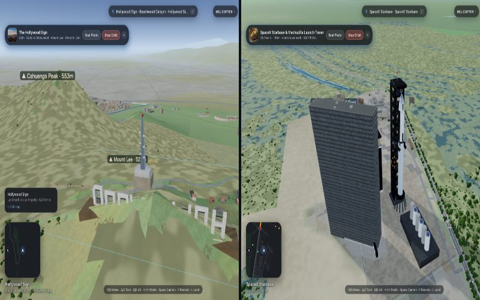<br><sub><b>Mount Lee & SpaceX Starbase</b> — 3D terrain-draped Hollywood Sign & Starbase Mechazilla pad</sub></td>
    <td width="33%">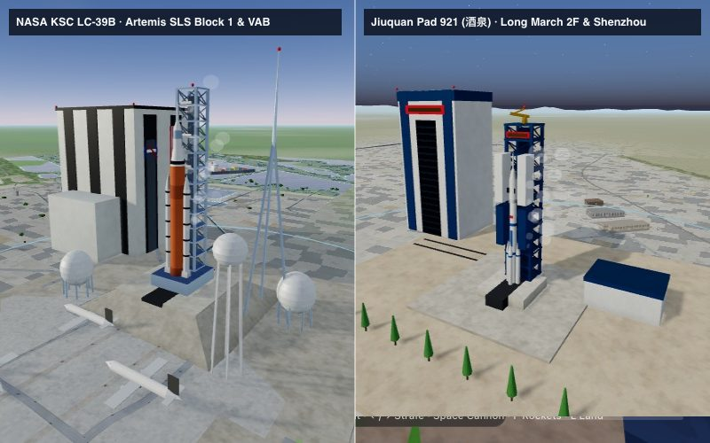<br><sub><b>Multi-Agency Spaceports</b> — NASA KSC LC-39B (SLS + VAB) & Jiuquan Pad 921 (Long March 2F)</sub></td>
    <td width="33%">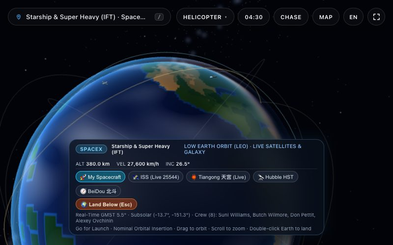<br><sub><b>Low Earth Orbit (380 km)</b> — Real-time GMST globe, Milky Way, live ISS, Tiangong & Hubble</sub></td>
  </tr>
</table>

---

## ✈️ Commercial Airliners (`Boeing 787 / Airbus A350`), GTA-Style Vehicles & Kaiju Defense

Walk onto any international airport tarmac (**SFO, LAX, JFK, LHR, HND, CDG, PEK, PVG, SIN, DXB, SYD…**) and press **`F / E`** to board a parked **Boeing 787-10 Dreamliner** or **Airbus A350-900**:
- **Full Ground-to-Cruise Envelope (`0 → 12,500 m`)**: Reverse thrust pushback (`S`), nosewheel steering (`A / D`), rotation at `V_R ≈ 145 kt` (`Space / Q`), automatic gear retraction, contrails, and climbing above the 3D volumetric cloud deck (`920 km/h` / Mach 0.85).
- **GTA-Style Street Vehicles, Boats & Sculpted Humans**: Enter any parked car or moored boat (`F / E`), switch between 11 garage vehicles (`G`), engage in infantry/vehicle combat with destructible car wrecks, and interact with sculpted 11-part anatomical pedestrians featuring 15-point constrained Verlet ragdoll physics.

<table>
  <tr>
    <td width="33%">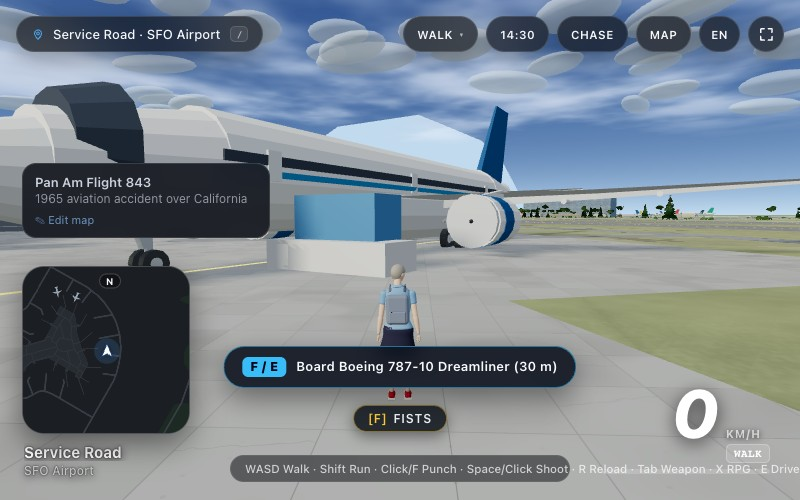<br><sub><b>Airport Tarmac Boarding</b> — Walk up to any parked Boeing 787-10 or Airbus A350 and press <code>F / E</code></sub></td>
    <td width="33%">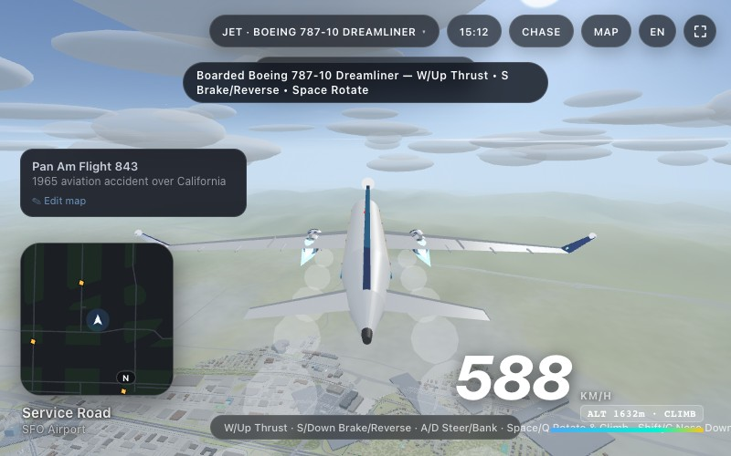<br><sub><b>Cloud-Deck Climb</b> — Piloting a Boeing 787-10 through the 3D cloud layer up to 12,500 m</sub></td>
    <td width="33%"><br><sub><b>Kaiju Swarm Defense</b> — Switch between Army Soldier, Tank, Attack Helicopter & Fighter Jet</sub></td>
  </tr>
</table>

---

## 🏘️ 100% Map-Tile 3D Coverage (`16` MVT Layers · `599` Classes & Subclasses)

Every single OpenMapTiles Z14 feature class across all 16 vector layers is procedurally synthesized into rich 3D architecture and street life at 60 FPS:
- **Architectural Realism**: Raycasted 3D interior cube-mapped windows (furnished offices, retail shops, warm residential rooms), Victorian 3-sided bay windows with pastel palettes and cornices, suburban curb-appeal lots (driveways, garages, front paths, lawn trees, backyard pools), and procedural flat roofs with HVAC chillers, solar arrays, skylight strips, and water tanks.
- **599 Real-Map POIs & Landuse Classes**: Brand-colored gas station canopies (`Shell`, `Chevron`, `76`, `Mobil`, `Sinopec`) with pump islands & price totems, convenience marts (`7-Eleven`, `FamilyMart`, `Lawson`), car wash tunnels, dining patios with umbrellas, pubs, hotels, cinemas, auto repair lifts, marketplaces, stadiums, tennis/basketball/soccer pitches, skateparks, cemeteries, zoos, waterparks, emergency services, world religious architecture, and street furniture.

<table>
  <tr>
    <td width="33%">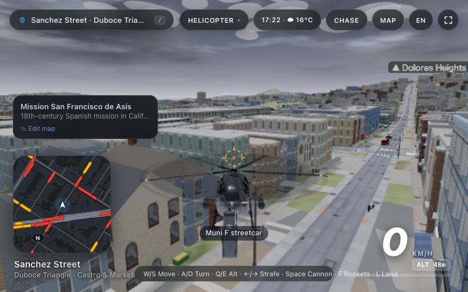<br><sub><b>Victorian Architecture & Transit</b> — 3-sided bay windows, Muni F streetcars & hillside streets</sub></td>
    <td width="33%">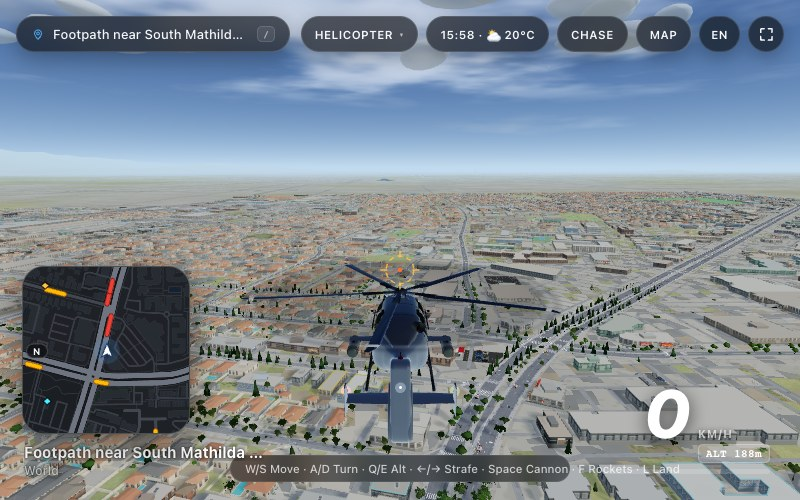<br><sub><b>Suburban Curb Appeal at 60 FPS</b> — Detached houses, driveways, trees & commercial plazas</sub></td>
    <td width="33%"><br><sub><b>Street Level Life</b> — Driving through Union Square with traffic, signals, storefronts & pedestrians</sub></td>
  </tr>
</table>

---

## ✨ What's in the World

| Feature | Highlights |
| :-- | :-- |
| 🚁 **Fly, Drive, Sail, Walk, Launch** | Arcade helicopter with auto-land (`L`), commercial widebody jets (`Boeing 787` / `Airbus A350`), multi-stage orbital rockets, 11 street vehicles (from taxis to a Mach-1 hypercar and tank), drivable moored boats, and on foot. |
| 🏙️ **599-Class Living Cities** | 100% OpenMapTiles 3D coverage across 16 MVT layers: AI road traffic on the correct side for each country, traffic signals, lane markings, gas stations, convenience marts, dining patios, sports courts, parks, rail, and ferries. |
| 🏛️ **102+ Landmarks & 120+ Tech HQ** | Hand-crafted 3D icons at exact coordinates: Apple Park, Googleplex, Google Bay View, NVIDIA HQ, Meta, OpenAI, Microsoft, Golden Gate Bridge, Eiffel Tower, Sagrada Família, Burj Khalifa, Taj Mahal, Sydney Opera House, SF City Hall, Hollywood Sign, US Capitol & more. |
| 📸 **Real-Estate Photo-to-3D** | Click any building or landmark for live Wikimedia Commons / Wikidata photos, architectural metadata, 360° **Drone Orbit**, client-side **Photo-to-3D Building Reconstruction**, and `.glb` parcel mesh overrides. |
| 🚀 **Spaceports & Orbital Earth** | 6 global launchpads (SpaceX Starbase, NASA KSC LC-39B, Jiuquan, Baikonur, Kourou, Tanegashima) launching into a real-time J2000/GMST 3D Earth with the Milky Way, live ISS, Tiangong, Hubble & CelesTrak satellites. |
| 📡 **Live Global Telemetry** | Real local time & weather ([Open-Meteo](https://open-meteo.com)), real sea state, NOAA aurora nowcast, live AIS ships (Digitraffic, Entur, WSDOT, NYC Ferry), live BART trains, live ADS-B aircraft, and real-time NYC / London / Hong Kong traffic speeds. |
| 🦖 **Kaiju Swarm Defense** | Up to 3 Kaiju rise from the nearest water with atomic heat rays. Defend the city across 4 combat roles: **Army Soldier**, **Main Battle Tank**, **Attack Helicopter**, or **Fighter Jet**. |
| ⚡ **60 FPS Frame Governor** | Off-thread Web Worker chunk builder, merged vertex-colored static buffers, GPU instanced props, and a proactive 60 FPS frame-budget governor with dynamic pixel-ratio and shadow distance scaling. |

---

## 🎮 Controls

| Key | Action |
| :-- | :-- |
| `W` `A` `S` `D` / Arrows | Move, steer, or pitch/bank |
| `1` `2` `3` | Switch mode: **Drive** (`1`) · **Walk** (`2`) · **Helicopter** (`3`) |
| `4` | **Kaiju Defense** (then `1` `2` `3` `4` switches Gunship / Tank / Soldier / Fighter Jet) |
| `F` / `E` | **Contextual Interact**: Board parked Airliner · Launch Orbital Rocket · Enter/Exit Car or Boat |
| `Space` / `Q` · `Shift` / `C` | **Airliner**: Rotate & climb / descend · **Helicopter**: `Q` / `E` altitude, `L` auto-land |
| `G` | Cycle garage vehicle while driving |
| `V` | Cycle camera view (`Shift` + `V` while driving) |
| `Click` | **Inspect any 3D building/landmark** (opens Photo-to-3D & Drone Orbit card) · **On foot**: shoot / punch |
| `Space` / `X` | Fire primary weapon / heavy weapon (`X` fires RPG on foot) |
| `R` / `Tab` | Reload weapon / cycle owned infantry weapons |
| `Shift` | Boost (vehicle / helicopter / sprint) |
| `H` | Horn or emergency siren |
| `M` | World Map (click anywhere to teleport; toggle live traffic overlay) |
| `/` | Search any place, landmark, spaceport, or company HQ |
| `Esc` | Exit Orbital Space View (triggers plasma re-entry) or close modal |
| `Shift` + `F` | Toggle Full Screen |

**URL Parameters:**
`?lat=…&lon=…&name=…` start location · `?time=0-24` time of day · `?weather=clear|cloudy|rain|fog` ·
`?sea=calm|moderate|rough|storm` · `?aurora=0-1|off` · `?sats=off|starlink` ·
`?traffic=live|typical|off` · `?ships=sim|off` · `?touch=1|0`

---

## 🛠️ Run It Yourself

```bash
python3 server.py                      # → http://localhost:8098
```

or with Docker:

```bash
docker build -t world-explorer . && docker run -p 8098:8098 world-explorer
```

Zero build step and zero required API keys. `server.py` serves the application along with `/api/sky` (live ADS-B aircraft proxy) and `/api/ships` (live maritime vessel relay). The app also runs from any static host (including GitHub Pages).

**Single-File Release Build:**
`world_explorer.html` packages the entire engine into a single self-contained HTML file. Regenerate it after modifying `src/` with:

```bash
python3 tools/build_release.py
```

---

## 📜 Data & Credits

All open data, streamed directly in the browser:
Map data © [OpenStreetMap](https://www.openstreetmap.org/copyright) contributors via [OpenFreeMap](https://openfreemap.org) & Overpass · Elevation from AWS Terrarium tiles (Mapzen) · Architectural photos & metadata from [Wikimedia Commons](https://commons.wikimedia.org) & [Wikidata](https://www.wikidata.org) · Search by Photon, Nominatim & BigDataCloud · Weather & sea state by [Open-Meteo](https://open-meteo.com) · Aurora nowcast from [NOAA SWPC](https://www.swpc.noaa.gov) · Live ISS telemetry from [WhereTheISS.at](https://wheretheiss.at) & satellite orbits from [CelesTrak](https://celestrak.org) via `satellite.js` (MIT) · Aircraft from OpenSky, `adsb.fi` & `adsb.lol` · Ships from Fintraffic Digitraffic (CC BY 4.0), Entur (NLOD), WSDOT, NYC Ferry, TransLink & [aisstream.io](https://aisstream.io) · Road traffic from [NYC DOT](https://data.cityofnewyork.us/Transportation/DOT-Traffic-Speeds-NBE/i4gi-tjb9), [TfL Open Data](https://tfl.gov.uk/info-for/open-data-users/), [DATA.GOV.HK](https://data.gov.hk) & optional [TomTom](https://www.tomtom.com) · Trains from BART API · Climate zones from Köppen–Geiger · Buildings enriched with [Overture Maps](https://overturemaps.org) · 3D rendering by [Three.js](https://threejs.org).

## 📄 License

Code released under the [MIT License](LICENSE). Map-derived files in `data/` contain OpenStreetMap data, © OpenStreetMap contributors, under the [Open Database License (ODbL)](https://opendatacommons.org/licenses/odbl/).
