<div align="center">

# 🌍 World Explorer

### The whole planet as an interactive 3D open world — live in your browser at 60 FPS.

Fly a commercial airliner on 6-phase FSD autopilot between real ICAO/IATA airports, launch a multi-stage Starship into Low Earth Orbit, engage 15-angle LiDAR Full Self-Driving across real streets and underwater river tunnels, command 10 maritime vessel classes, skydive in 3D freefall, inspect real-estate parcels with live Photo-to-3D reconstruction, or defend the city from a Kaiju swarm. Real streets, real buildings, real terrain, real weather, and live global telemetry — rebuilt in 3D around you at 1:1 scale as you move.

**[▶ Play it now](https://axieyangb.github.io/world-explorer/)** · [🎬 Watch the 30 s trailer](https://github.com/axieyangb/world-explorer/releases/latest)


<a href="https://axieyangb.github.io/world-explorer/">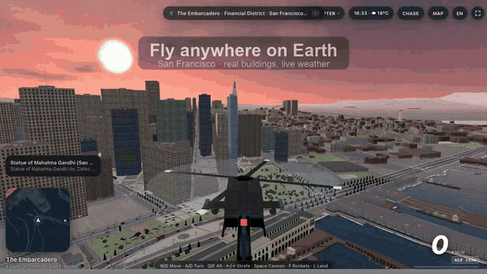</a>

</div>

---

## 🌐 Go Anywhere on Earth

Type any place or street address, click the world map, or pass coordinates in the URL. Within seconds, a **40 km × 40 km** detailed chunk grid backed by a **120 km seamless horizon skirt** streams in from Z14 OpenMapTiles vector tiles and AWS Terrarium elevation DEMs off the main thread.

<table>
  <tr>
    <td width="33%">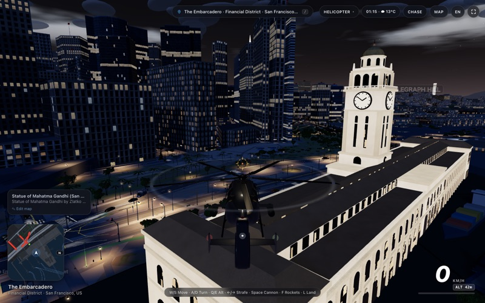<br><sub><b>San Francisco</b> — Ferry Building & raycasted 3D interior room parallax skyscraper windows at night</sub></td>
    <td width="33%">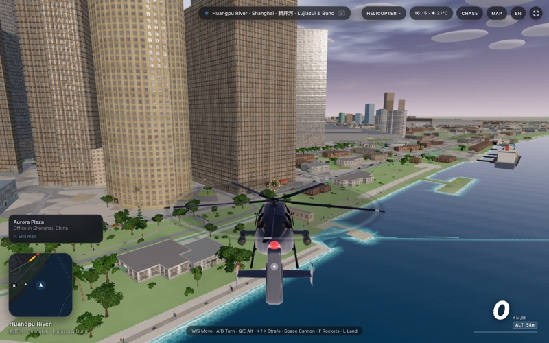<br><sub><b>Shanghai</b> — Lujiazui supertalls, Huangpu River underwater tunnels, and docked vessels</sub></td>
    <td width="33%">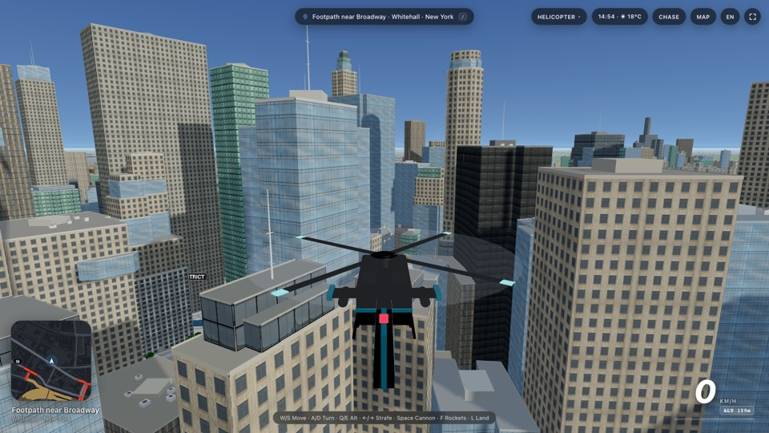<br><sub><b>New York</b> — Flying between the towers of Lower Manhattan</sub></td>
  </tr>
  <tr>
    <td>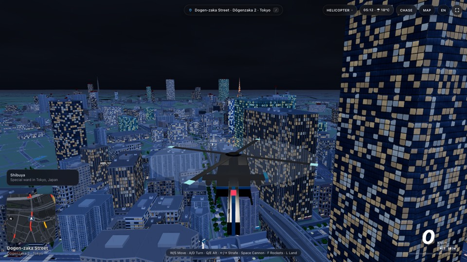<br><sub><b>Tokyo</b> — Shibuya Crossing and neon signage before dawn</sub></td>
    <td>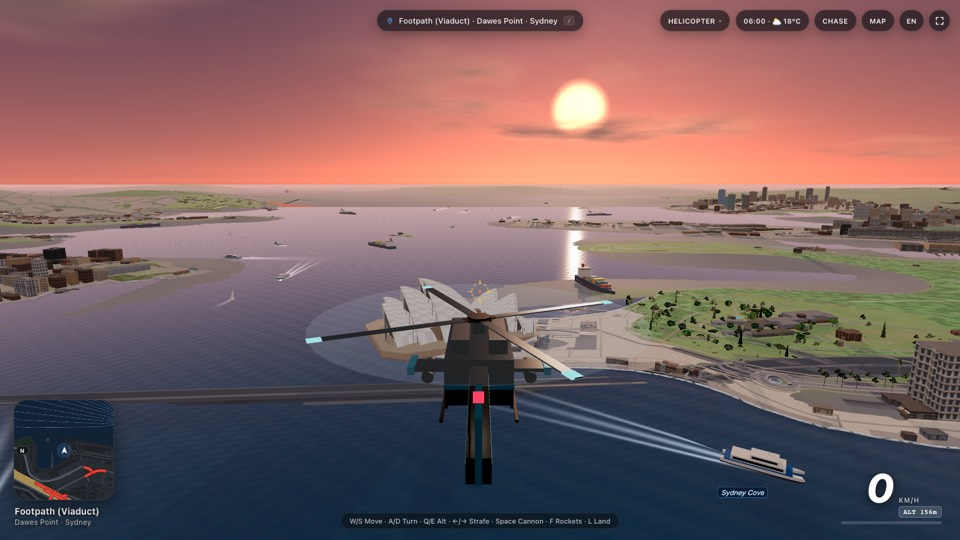<br><sub><b>Sydney</b> — Sunrise over the Opera House and harbour ferries</sub></td>
    <td>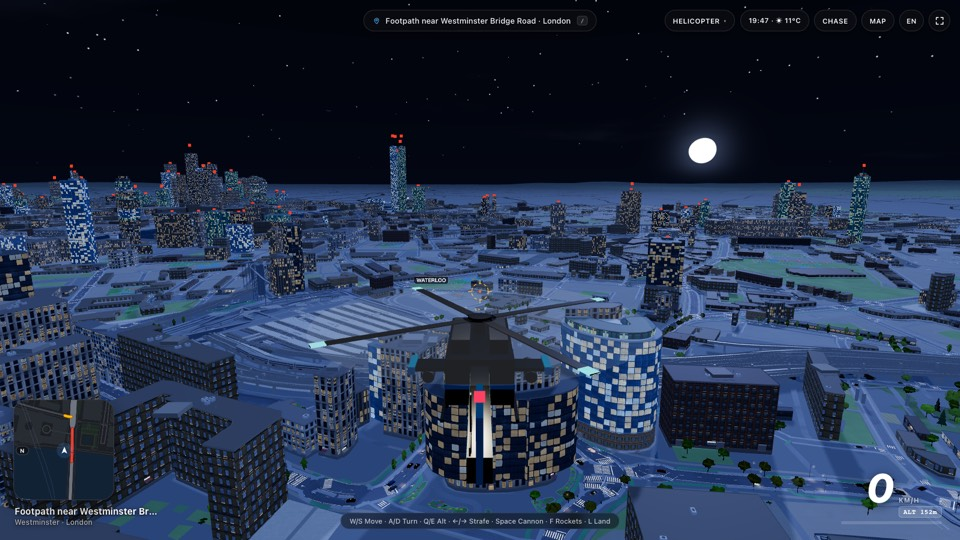<br><sub><b>London</b> — Waterloo and the Thames under a full moon</sub></td>
  </tr>
</table>

**Instant Teleport Links:**
[San Francisco](https://axieyangb.github.io/world-explorer/?lat=37.7955&lon=-122.3937&name=San%20Francisco) ·
[Shanghai Lujiazui](https://axieyangb.github.io/world-explorer/?lat=31.2397&lon=121.4998&name=Shanghai) ·
[New York](https://axieyangb.github.io/world-explorer/?lat=40.7060&lon=-74.0130&name=New%20York) ·
[Tokyo](https://axieyangb.github.io/world-explorer/?lat=35.6595&lon=139.7005&name=Tokyo) ·
[Paris](https://axieyangb.github.io/world-explorer/?lat=48.8584&lon=2.2945&name=Paris) ·
[London](https://axieyangb.github.io/world-explorer/?lat=51.5010&lon=-0.1200&name=London) ·
[Sydney](https://axieyangb.github.io/world-explorer/?lat=-33.8570&lon=151.2100&name=Sydney) ·
[Apple Park](https://axieyangb.github.io/world-explorer/?lat=37.3349&lon=-122.0090&name=Apple%20Park) ·
[SpaceX Starbase](https://axieyangb.github.io/world-explorer/?lat=25.9968&lon=-97.1544&name=SpaceX%20Starbase)

---

## 🧭 All Transport Modes & Universal All-Mode FSD (Full Self-Driving)

Set any destination on the map or search bar and engage **Universal FSD Autopilot** across foot, road, rail/tunnel, sea, air, and orbit:

- **🚶 Walk**: 3D articulated human & custom avatars, sidewalk-aware local A* navigation around building footprints, mid-air skydiving/freefall with 3D tumbling & limb flailing, sea swimming/drowning & fall-damage physics, pedestrian interactions (15-point Verlet ragdolls, carjacking), and infantry weapons.
- **🚗 Drive (Car & Tank)**: 11 drivable vehicles with progressive speed-sensitive real-car steering, synchronous in-memory **A* Road Router** + OSRM fallback, **15-angle LiDAR FSD** avoiding moving AI traffic & parked cars (**ACC** adaptive cruise, **AEB** emergency braking, dynamic lane-change overtaking), cross-river underwater tunnels (e.g., Shanghai Huangpu River tunnels) & multi-level bridges, plus vehicle damage & burnt wreck physics.
- **✈️ Airliner (`Boeing 787-9 Dreamliner` & `Airbus A350`)**: Spawn or board at real airports worldwide (`SFO`, `LAX`, `JFK`, `LHR`, `HND`, `CDG`, `PEK`, `PVG`, `SIN`, `DXB`, `SYD`…), 1:1 WGS84 altitude (`m` / `ft`) and groundspeed (`km/h` / `kts` / `Mach`) telemetry, **6-phase FSD Autopilot** (`TAKEOFF ROLL → ROTATE → INITIAL CLIMB → CRUISE → APPROACH → AUTOLAND`) between real ICAO/IATA airports, conformal cockpit windscreen visor, **120 km seamless horizon skirt** & domain-warped volumetric clouds, and 3D mid-air/maritime collision physics.
- **🚁 Helicopter & Fighter Jet**: Attack helicopter & supersonic fighter jet flight dynamics, air-to-ground/air-to-air weapons, auto-land (`L`), and FSD point-to-point autopilot.
- **🚢 Boat / Maritime**: **10 detailed 3D vessel classes** (container ships, oil tankers, bulk cargo ships, car ferries, passenger ferries, tugboats, fishing boats, naval patrol ships, sailboats, and speedboats), waterfront piers, boat-to-boat collision physics, and water-channel FSD navigation.
- **🚀 Spaceflight & Orbital Earth**: 6 global launch complexes (**SpaceX Starbase**, **NASA Cape Canaveral LC-39B**, **Jiuquan Pad 921**, **Baikonur Site 1/5**, **ESA Kourou ELA-4**, **JAXA Tanegashima LA-Y2**), multi-stage Starship & orbital rocket launches (`0 → 380 km` LEO) into a real-time J2000/GMST orbital Earth view, live SGP4 satellite/ISS tracking, and hypersonic plasma re-entry into any city on Earth.

<table>
  <tr>
    <td width="33%">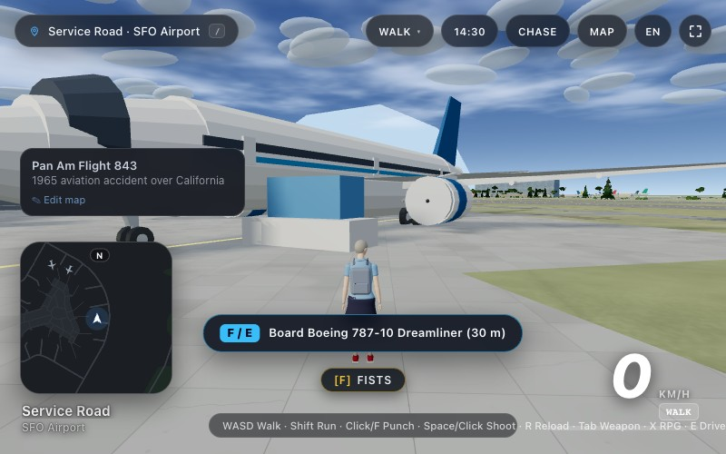<br><sub><b>Airport Tarmac & 6-Phase FSD</b> — Board a Boeing 787 or Airbus A350 and fly or autoland between real ICAO/IATA airports</sub></td>
    <td width="33%">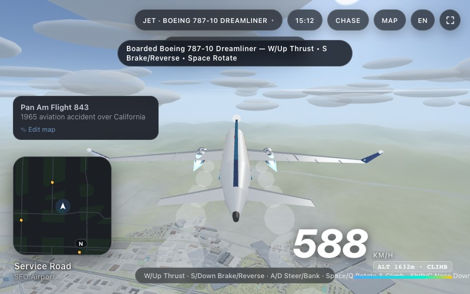<br><sub><b>120 km Horizon & Volumetric Clouds</b> — 1:1 WGS84 altitude (<code>m/ft</code>) and groundspeed (<code>km/h/kts/Mach</code>)</sub></td>
    <td width="33%">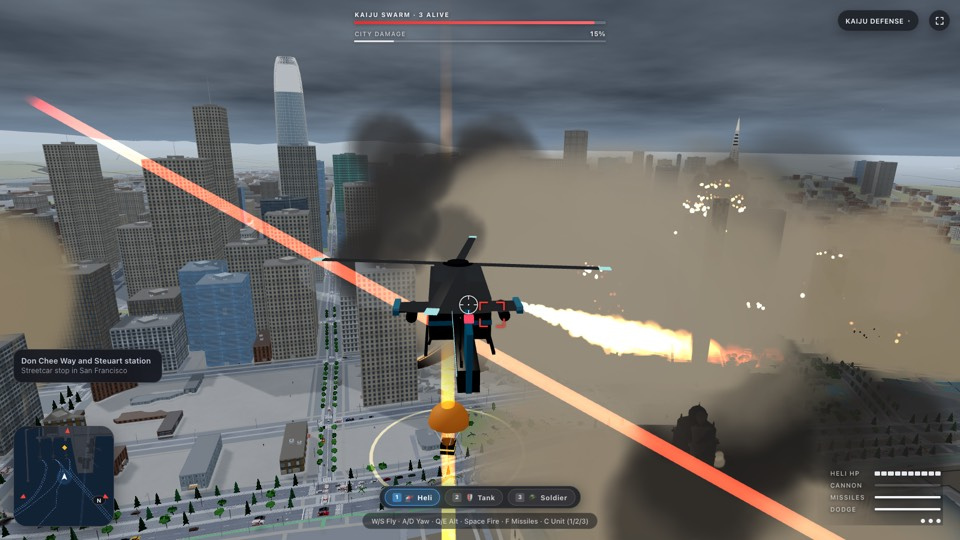<br><sub><b>Combat & Kaiju Defense</b> — Switch between Army Soldier, Main Battle Tank, Attack Helicopter & Fighter Jet</sub></td>
  </tr>
</table>

---

## 🏛️ Architectural & 3D World Detail (`599` MVT Classes · `42` Facade Layers)

Every OpenMapTiles Z14 feature class across all 16 vector layers is synthesized into 3D architecture, massing, and street life at 60 FPS:

- **42 Facade Layers (`24` Photo + `18` Procedural Regional Styles)**: High-precision UV-addressed atlas combining 24 photographic facade textures with 18 procedural regional styles — including **Art Deco**, **Haussmann**, **Brutalist**, **Tudor**, **Modern Timber**, **Neoclassical**, **Venetian Gothic**, and **High-Tech Diagrid**.
- **3D Massing, Setbacks & Interior Parallax**: **3D interior room parallax shader** (furnished offices, retail shops, warm residential rooms), **multi-tier skyscraper setbacks**, ground-floor **colonnades**, **cast-iron fire escapes**, and street-level **storefronts**.
- **8 3D Roof Typologies**: Swept East Asian **`xieshan` / `irimoya`** roofs, **Dutch stepped gables**, **mansard**, **gambrel**, **barrel-vault**, **pyramidal**, **hip**, and **gable** roofs, plus procedural flat-roof mechanical penthouses, HVAC chillers, solar arrays, and skylight strips.
- **6 Multi-Archetype 3D Infill Houses**: Suburban and urban residential parcels with attached/detached **garages**, **porches**, **3-sided Victorian bay windows**, **front stoops**, and landscaped **yards with swimming pools, pergolas, and greenhouses**.
- **100+ Hand-Built Global Landmarks & 120+ Tech Campuses**: Custom 3D icons at exact coordinates (Apple Park, Googleplex, Google Bay View, NVIDIA HQ, Meta, OpenAI, Microsoft, Golden Gate Bridge, Eiffel Tower, Sagrada Família, Burj Khalifa, Taj Mahal, Sydney Opera House, SF City Hall, Hollywood Sign, US Capitol & more) with live **Wikimedia Commons / Wikidata Inspector**, **360° Drone Orbit**, client-side **Photo-to-3D reconstruction**, and `.glb` parcel overrides.

<table>
  <tr>
    <td width="33%">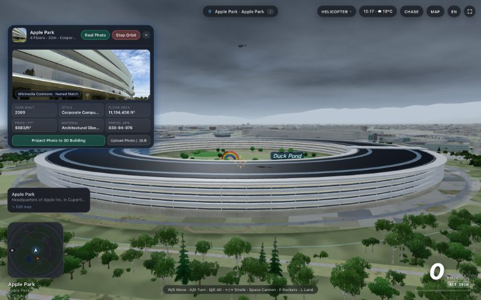<br><sub><b>Apple Park</b> — Norman Foster ring, solar roof, rainbow arches, Duck Pond & live Wikimedia Inspector</sub></td>
    <td width="33%">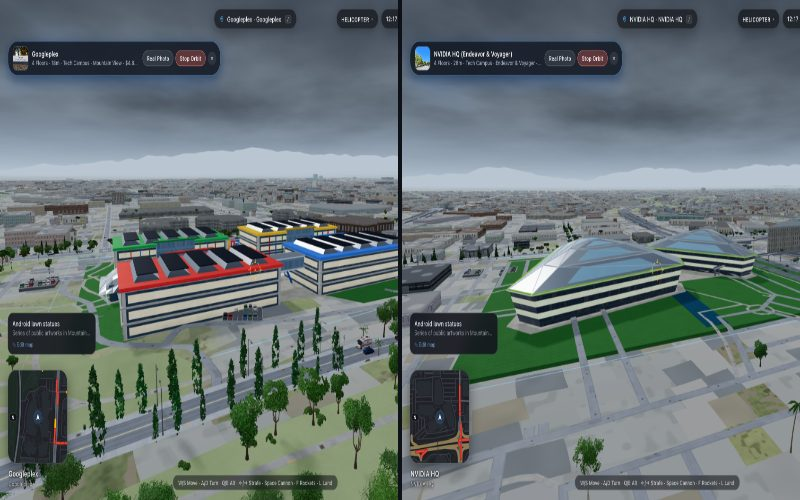<br><sub><b>Googleplex & NVIDIA HQ</b> — Open campus lawns, solar canopies & geodesic triangular domes</sub></td>
    <td width="33%">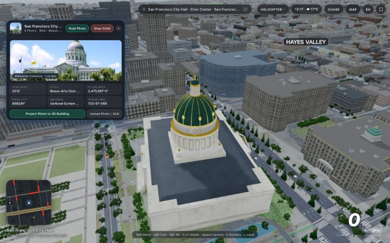<br><sub><b>Photo-to-3D Inspector</b> — SF City Hall Beaux-Arts dome with live photo projection & parcel metadata</sub></td>
  </tr>
  <tr>
    <td>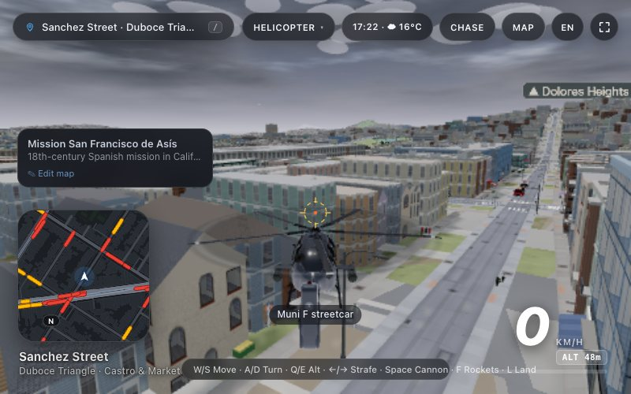<br><sub><b>Regional Roofs & Facades</b> — Victorian bay windows, stoops, cast-iron fire escapes & Muni streetcars</sub></td>
    <td>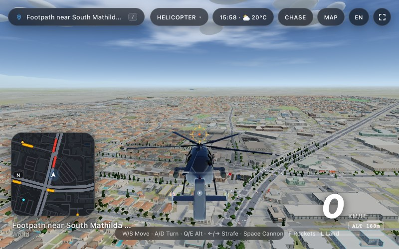<br><sub><b>3D Infill Houses & Yards</b> — Multi-archetype homes with garages, porches, pools, pergolas & greenhouses</sub></td>
    <td>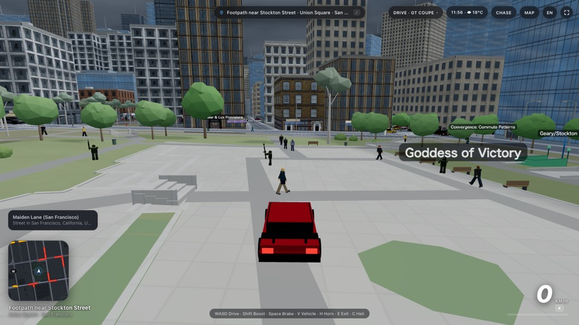<br><sub><b>15-Angle LiDAR FSD</b> — Autonomous driving through Union Square with ACC, AEB, lane changes & storefronts</sub></td>
  </tr>
</table>

---

## 📡 How Traffic & Live World Data Work (Hybrid Live Feeds + Real OSM Networks)

World Explorer blends real-time global telemetry feeds with high-density procedural simulation anchored to real OpenStreetMap geometry:

| Domain | Live Data Feeds & Real-World Synthesis |
| :-- | :-- |
| **✈️ Live ADS-B Flights** | Real-time aircraft positions, callsigns, altitudes, headings, and vertical rates streamed from **OpenSky Network**, **`adsb.fi`**, and **`adsb.lol`**, rendered as 3D widebody/narrowbody airliners in the sky and on airport radars. |
| **🛰️ Live NORAD Satellites & ISS** | Real-time orbital elements (`TLE` / `OMM`) from **CelesTrak** and live ISS telemetry (`wheretheiss.at`) propagated in the browser via **SGP4 (`satellite.js`)** — tracking the **ISS**, **Tiangong (`天宫`)**, **Hubble**, **Starlink**, and **BeiDou** across a J2000/GMST globe. |
| **🌦️ Live Weather, Sea State & Aurora** | Real local solar time, cloud cover, precipitation, wind, and wave heights from **[Open-Meteo](https://open-meteo.com)** coupled with **NOAA SWPC** planetary $K_p$ aurora oval nowcasts. |
| **🚢 Live Rail & Maritime AIS** | Real-time vessel transponders and ferry schedules from **Fintraffic Digitraffic AIS**, **aisstream.io**, **NYC Ferry**, **WSDOT**, and **Entur**, plus live **BART** rapid-transit train telemetry in the Bay Area. |
| **🚦 AI Road/Pedestrian Traffic + Live Sensors** | Multi-lane **OpenStreetMap** road & sidewalk graphs with country-correct driving side, junction turn reservations, stop bars, and pedestrian crosswalks — modulated by live city traffic speed sensors from **NYC DOT**, **London TfL**, **Hong Kong TD (`DATA.GOV.HK`)**, and optional **TomTom** flow data. |

<table>
  <tr>
    <td width="33%">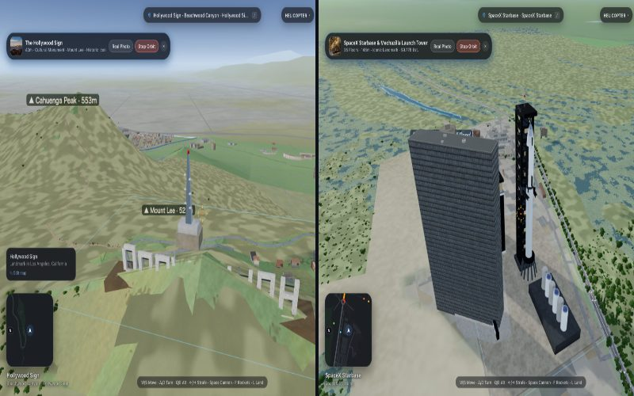<br><sub><b>Mount Lee & SpaceX Starbase</b> — 3D terrain-draped Hollywood Sign & Starbase Mechazilla pad</sub></td>
    <td width="33%">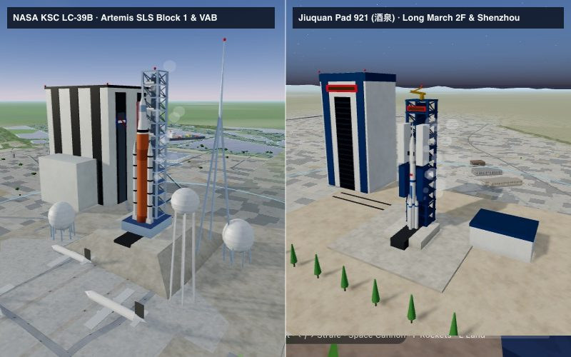<br><sub><b>Multi-Agency Spaceports</b> — NASA KSC LC-39B (SLS + VAB) & Jiuquan Pad 921 (Long March 2F)</sub></td>
    <td width="33%">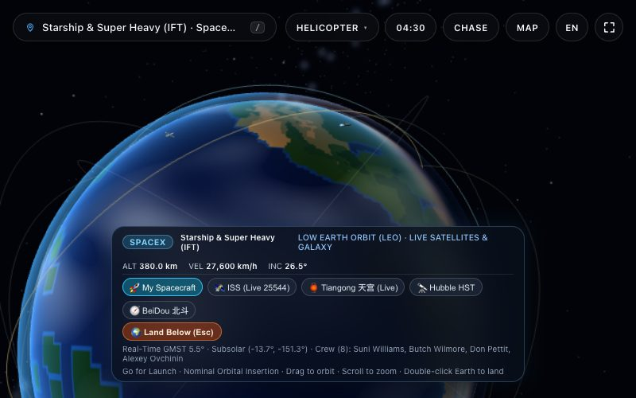<br><sub><b>Low Earth Orbit (380 km)</b> — Real-time GMST globe, Milky Way, live SGP4 satellites, ISS & Tiangong</sub></td>
  </tr>
</table>

---

## 🎮 Controls

| Key | Action |
| :-- | :-- |
| `W` `A` `S` `D` / Arrows | Move, progressive car steering, vessel helm, or aircraft pitch/bank |
| `1` `2` `3` | Switch mode: **Drive** (`1`) · **Walk** (`2`) · **Helicopter** (`3`) |
| `4` | **Kaiju Defense** (then `1` `2` `3` `4` switches Gunship / Tank / Soldier / Fighter Jet) |
| `F` / `E` | **Contextual Interact**: Board parked Airliner · Launch Orbital Rocket · Enter/Exit Car or Boat |
| `Space` / `Q` · `Shift` / `C` | **Airliner**: Rotate & climb / descend · **Helicopter**: `Q` / `E` altitude, `L` auto-land |
| `G` | Cycle garage vehicle while driving |
| `V` | Cycle camera view (`Shift` + `V` while driving) |
| `Click` | **Inspect any 3D building/landmark** (opens Photo-to-3D & Drone Orbit card) · **On foot**: shoot / punch |
| `Space` / `X` | Fire primary weapon / heavy weapon (`X` fires RPG on foot) |
| `R` / `Tab` | Reload weapon / cycle owned infantry weapons |
| `Shift` | Boost (vehicle / helicopter / sprint) |
| `H` | Horn or emergency siren |
| `M` | World Map (click anywhere to teleport or set **Universal FSD** destination; toggle live traffic overlay) |
| `/` | Search any place, airport, landmark, spaceport, or company HQ |
| `Esc` | Exit Orbital Space View (triggers plasma re-entry) or close modal |
| `Shift` + `F` | Toggle Full Screen |

**URL Parameters:**
`?lat=…&lon=…&name=…` start location · `?time=0-24` time of day · `?weather=clear|cloudy|rain|fog` ·
`?sea=calm|moderate|rough|storm` · `?aurora=0-1|off` · `?sats=off|starlink` ·
`?traffic=live|typical|off` · `?ships=sim|off` · `?touch=1|0`

---

## 🛠️ Server (`server.py`) & Single-File Release Bundle (`tools/build_release.py`)

### 1. Run Locally (`server.py` on port `8098`)

```bash
python3 server.py                      # → http://localhost:8098 (this machine only)
HOST=0.0.0.0 python3 server.py         # → also reachable from other machines on your network
```

or with Docker:

```bash
docker build -t world-explorer . && docker run -p 8098:8098 world-explorer
```

Zero build step and zero required API keys. `server.py` serves the modular ES-module app on port `8098` along with `/api/sky` (live ADS-B aircraft proxy for OpenSky / `adsb.fi` / `adsb.lol`) and `/api/ships` (live maritime AIS vessel relay). The app also runs directly from any static host (including GitHub Pages).

### 2. Build the Standalone Single-File Release (`world_explorer.html`)

`tools/build_release.py` compiles the entire engine (`src/`, Web Workers, shaders, and assets) into a **standalone, zero-dependency single-file `world_explorer.html`** that opens directly in any browser:

```bash
python3 tools/build_release.py         # → outputs standalone world_explorer.html
```

### 3. Check Before Pushing (`tools/check.sh`)

```bash
tools/check.sh                         # syntax, imports, lint, server tests, release build (about 10 s)
```

Needs only `node` and `python3`. The lint step is optional and needs ESLint once: `npm --prefix tools ci`. To run the checks on every `git push`, opt in with `tools/install_git_hook.sh`.

---

## 📜 Data & Credits

All open data, streamed directly in the browser:
Map data © [OpenStreetMap](https://www.openstreetmap.org/copyright) contributors via [OpenFreeMap](https://openfreemap.org) & Overpass · Elevation from AWS Terrarium tiles (Mapzen) · Architectural photos & metadata from [Wikimedia Commons](https://commons.wikimedia.org) & [Wikidata](https://www.wikidata.org) · Search by Photon, Nominatim & BigDataCloud · Weather & sea state by [Open-Meteo](https://open-meteo.com) · Aurora nowcast from [NOAA SWPC](https://www.swpc.noaa.gov) · Live ISS telemetry from [WhereTheISS.at](https://wheretheiss.at) & satellite orbits from [CelesTrak](https://celestrak.org) via `satellite.js` (MIT) · Aircraft from OpenSky, `adsb.fi` & `adsb.lol` · Ships from Fintraffic Digitraffic (CC BY 4.0), Entur (NLOD), WSDOT, NYC Ferry, TransLink & [aisstream.io](https://aisstream.io) · Road traffic from [NYC DOT](https://data.cityofnewyork.us/Transportation/DOT-Traffic-Speeds-NBE/i4gi-tjb9), [TfL Open Data](https://tfl.gov.uk/info-for/open-data-users/), [DATA.GOV.HK](https://data.gov.hk) & optional [TomTom](https://www.tomtom.com) · Trains from BART API · Climate zones from Köppen–Geiger · Buildings enriched with [Overture Maps](https://overturemaps.org) · 3D rendering by [Three.js](https://threejs.org).

## 📄 License

Code released under the [MIT License](LICENSE). Map-derived files in `data/` contain OpenStreetMap data, © OpenStreetMap contributors, under the [Open Database License (ODbL)](https://opendatacommons.org/licenses/odbl/).
