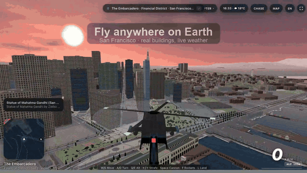
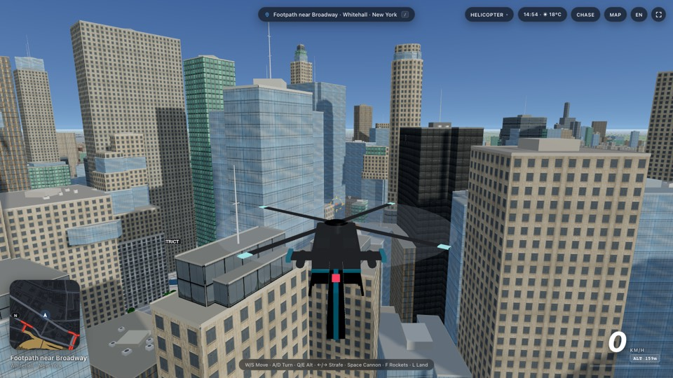
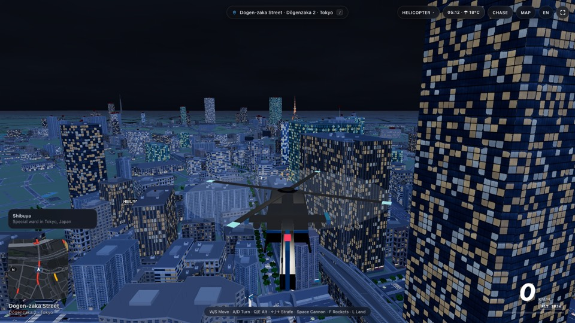
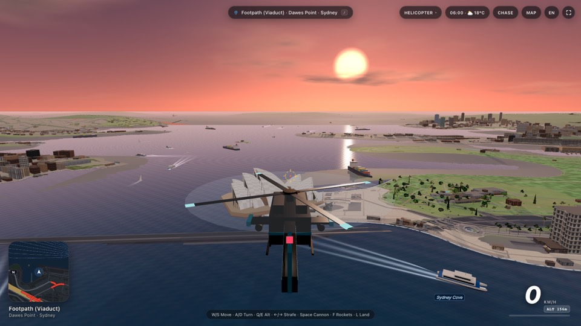
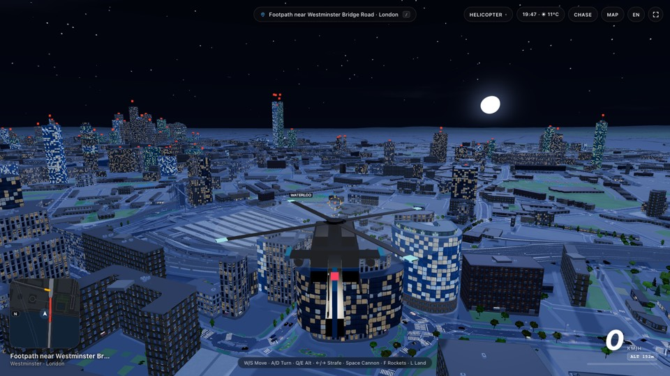
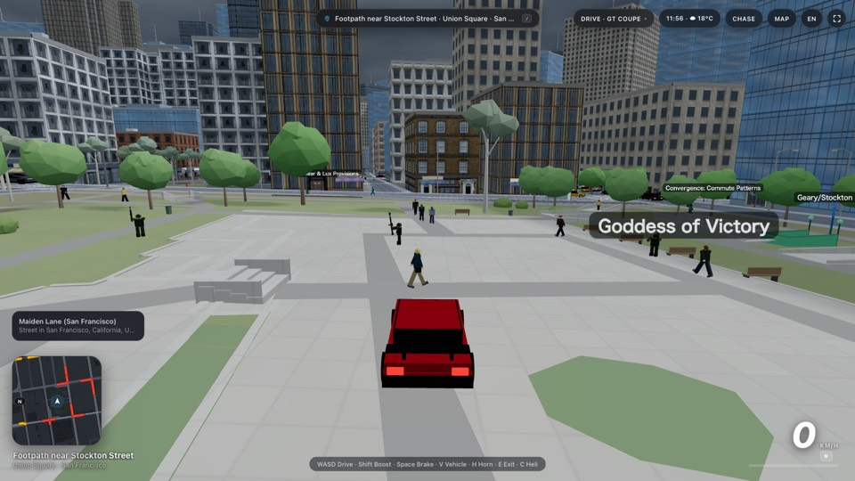
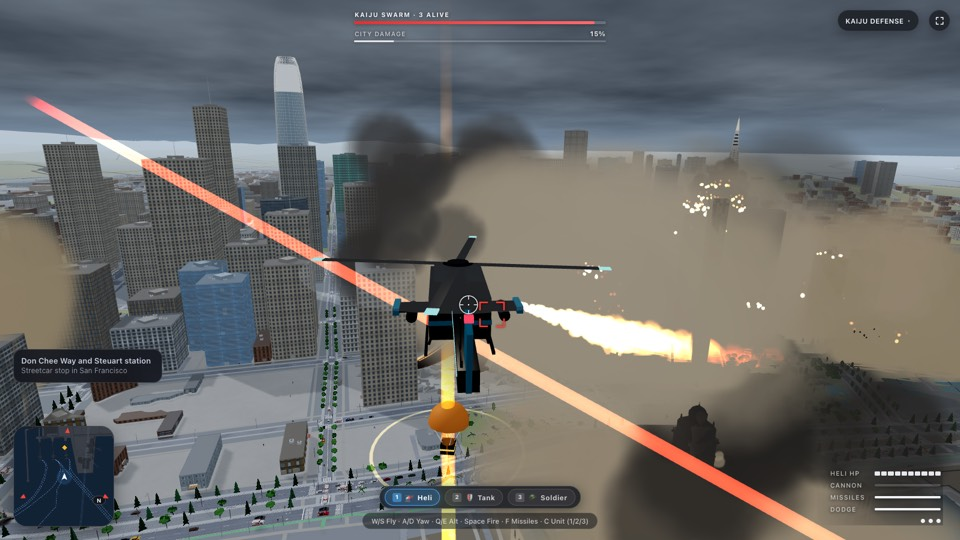

<div align="center">

# 🌍 World Explorer

### The whole planet as an open world, live in your browser.

Fly, drive or walk anywhere on Earth. Real streets, real buildings, real terrain and real weather,
rebuilt in 3D around you at 1:1 scale as you move.

**[▶ Play it now](https://axieyangb.github.io/world-explorer/)** · [🎬 Watch the 30 s trailer](https://github.com/axieyangb/world-explorer/releases/latest)


<a href="https://axieyangb.github.io/world-explorer/"></a>

</div>

## Go anywhere

Type a place, click the world map, or put coordinates in the URL. The world builds itself in seconds:
40 km × 40 km of terrain, roads, buildings, water and street life streamed from open map data.

<table>
  <tr>
    <td width="33%"><br><sub><b>New York</b>, between the towers of Lower Manhattan</sub></td>
    <td width="33%"><br><sub><b>Tokyo</b>, Shibuya before dawn</sub></td>
    <td width="33%"><br><sub><b>Sydney</b>, sunrise over the Opera House and harbour ferries</sub></td>
  </tr>
  <tr>
    <td><br><sub><b>London</b>, Waterloo under a full moon</sub></td>
    <td><br><sub><b>Street level</b>, driving through Union Square with pedestrians and traffic</sub></td>
    <td><br><sub><b>Kaiju Defense</b>, holding off a swarm over downtown</sub></td>
  </tr>
</table>

Try it:
[Paris](https://axieyangb.github.io/world-explorer/?lat=48.8584&lon=2.2945&name=Paris) ·
[New York](https://axieyangb.github.io/world-explorer/?lat=40.7060&lon=-74.0130&name=New%20York) ·
[Tokyo](https://axieyangb.github.io/world-explorer/?lat=35.6595&lon=139.7005&name=Tokyo) ·
[Sydney](https://axieyangb.github.io/world-explorer/?lat=-33.8570&lon=151.2100&name=Sydney) ·
[London](https://axieyangb.github.io/world-explorer/?lat=51.5010&lon=-0.1200&name=London) ·
[San Francisco by night](https://axieyangb.github.io/world-explorer/?time=21)

## What's in the world

| | |
| :-- | :-- |
| 🚁 **Fly, drive, walk** | An arcade helicopter with auto-land and rooftop landings, a garage of 11 vehicles from taxis and buses to a Mach-1 hypercar and a tank, and on foot. |
| 🏙️ **Living cities** | AI traffic and pedestrians on the real road network, driving on the correct side for each country. Traffic lights, signs, street lamps, trees, trains and ferries. |
| ✈️ **Live data** | The real local time and weather wherever you are, the real sea state on the water, the northern lights when they're out, real satellites and the ISS crossing the night sky, live trains and ships where open feeds exist, live road traffic in New York, London and Hong Kong (and anywhere with your own TomTom key; elsewhere a realistic rush-hour / night pattern), and real aircraft overhead when served by `server.py`. |
| 🌅 **Sky and climate** | Sun, moon and stars in the right place for the real time, rain, fog, snow and cloud, and vegetation chosen for each region's climate zone. Pick dawn, noon, dusk or night any time; *Now* goes back to live. |
| 🗼 **Landmarks** | 73 hand-modelled icons at their real coordinates: the Golden Gate Bridge, Eiffel Tower, Sagrada Família, Hagia Sophia, Burj Khalifa, Taipei 101, Angkor Wat, the Pyramids, Taj Mahal, Sydney Opera House, the US Capitol and more. |
| 🪧 **Sense of place** | Storefront signs, a *Welcome to…* banner when you cross a border, and a Wikipedia card for whatever landmark you're looking at, with a one-tap *Edit map* link to fix that spot on OpenStreetMap. |
| 🦖 **Kaiju Defense** | A giant creature rises from the nearest water. Defend the city as a gunship, tank or soldier. |
| 🌐 **English / 中文** | Full bilingual interface with local road names. |
| 📱 **Phones and tablets** | On-screen joystick and action buttons, drag to look, pinch to zoom. Add it to your home screen to play full screen. |

## Controls

| Key | Action |
| :-- | :-- |
| `W` `A` `S` `D` / arrows | Move and steer |
| `1` `2` `3` | Drive / walk / helicopter |
| `4` | Kaiju Defense (then `1` `2` `3` picks gunship / tank / soldier) |
| `Q` / `E` | Helicopter altitude |
| `L` | Helicopter auto-land |
| `F` | Rockets in the air; switch between driving and walking on the ground |
| `E` | Enter or leave a vehicle |
| `G` | Next vehicle |
| `V` | Next camera (`Shift` + `V` while driving) |
| `Space` / `X` | Fire / heavy weapon (on foot: needs a weapon you picked up; `X` fires your RPG) |
| Click | On foot: punch when unarmed, shoot with a weapon (hold still to keep firing; dragging only looks around) |
| `R` / `Tab` | On foot: reload (switches weapon when the magazine is full) / next weapon you own |
| `Shift` | Boost |
| `H` | Horn or siren |
| `M` | World map (click anywhere to teleport) |
| `/` | Search for a place |
| `Shift` + `F` | Full screen |

**On foot you start unarmed.** Weapons and ammo cans lie around the city (sidewalks, alleys, parks, low rooftops,
next to parked police cars), marked by a faint light beam and on the minimap: walk over one to pick it up. Assault
rifles are common, RPGs rare and railguns very rare; ammo is limited (rifle 30 / 90, RPG 1 / 3, railgun 4 / 8) and
you go back to your fists when it runs out. A new city starts you empty-handed again. Vehicles keep their own guns.

**On a phone or tablet:** left thumb on the joystick to move or steer; right-thumb buttons change with the mode
(fire, rockets, climb/descend and land in the helicopter; boost, brake, horn and exit in a car; punch or fire, run, reload and enter on foot).
Drag the view to look around, pinch to zoom, tap the mode button at the top to switch, and tap **MAP** then anywhere to go there.
Touch controls appear automatically on touch devices; `?touch=1` or `?touch=0` forces them on or off.

**URL options:** `?lat=…&lon=…&name=…` start location · `?time=0-24` time of day · `?weather=clear|cloudy|rain|fog` ·
`?sea=calm|moderate|rough|storm` · `?aurora=0-1|off` · `?sats=off|starlink` (adds the full Starlink fleet) ·
`?traffic=live|typical|off` (live feeds, the typical time-of-day pattern only, or the old uniform traffic)

**Live traffic** lives in the time & weather menu (Live / Typical / Off). For live traffic outside New York, London and
Hong Kong, paste a free [TomTom](https://developer.tomtom.com) API key there; it is kept only in your browser's local storage.
The congestion overlay (green / amber / red) is the traffic-light button on the world map, and shows on the minimap too.

## Run it yourself

```bash
python3 server.py                      # → http://localhost:8098
```

or with Docker:

```bash
docker build -t world-explorer . && docker run -p 8098:8098 world-explorer
```

No build step and no keys. `server.py` serves the files plus a small `/api/sky` proxy for live aircraft
(ADS-B feeds don't allow direct browser calls). The page works from any static host and any sub-path too
(the GitHub Pages demo is exactly that), with simulated air traffic instead of live aircraft.

**Single-file build.** `world_explorer.html` is the entire app in one self-contained file. Regenerate it after
changing the source with `python3 tools/build_release.py`, and register any new module in its `MOD_ID_MAP`.

## How it works

- **Streaming world.** A teleport sets a local metric origin, then a Web Worker fetches OpenFreeMap vector
  tiles and Terrarium elevation tiles and builds 1 km chunks (terrain, roads with bridges and lane graphs,
  extruded buildings, water, vegetation, rail, street furniture) off the main thread.
- **Rendering.** Three.js on WebGL2 with instanced meshes for traffic, trees and props, procedural facade
  textures, and shader-driven night lighting, water and weather.
- **Code layout.** `src/main.js` runs the engine loop, modes and HUD. `src/global_tiles.js` and
  `src/chunk_builder.js` build the world. Each feature lives in its own module under `src/features/`
  (traffic, vehicles, helicopter, rail, maritime, places, weather, landmarks, kaiju…).

## Data and credits

All open data, fetched straight from the browser:
map data © [OpenStreetMap](https://www.openstreetmap.org/copyright) contributors via
[OpenFreeMap](https://openfreemap.org) and Overpass · elevation from AWS Terrarium tiles (Mapzen) ·
search by Photon, Nominatim and BigDataCloud · weather and sea state by [Open-Meteo](https://open-meteo.com) ·
aurora nowcast from [NOAA SWPC](https://www.swpc.noaa.gov) · satellite orbits from [CelesTrak](https://celestrak.org) via satellite.js (MIT) ·
aircraft from OpenSky, adsb.fi and adsb.lol · ships from Fintraffic Digitraffic (CC BY 4.0) ·
road traffic from [NYC DOT](https://data.cityofnewyork.us/Transportation/DOT-Traffic-Speeds-NBE/i4gi-tjb9) real-time speeds,
Powered by [TfL Open Data](https://tfl.gov.uk/info-for/open-data-users/) (contains OS data © Crown copyright and database rights),
Hong Kong Transport Department detectors via [DATA.GOV.HK](https://data.gov.hk), and optionally © [TomTom](https://www.tomtom.com) with your own key ·
trains from the BART API · climate zones from Köppen–Geiger (Kottek et al. 2006) ·
buildings enriched with [Overture Maps](https://overturemaps.org) · rendering by [Three.js](https://threejs.org).

## License

The code is released under the [MIT License](LICENSE).

Map-derived files in `data/` contain OpenStreetMap data, © OpenStreetMap contributors, available under the
[Open Database License](https://opendatacommons.org/licenses/odbl/). `vendor/three.module.js` is Three.js,
© Three.js authors, MIT.
